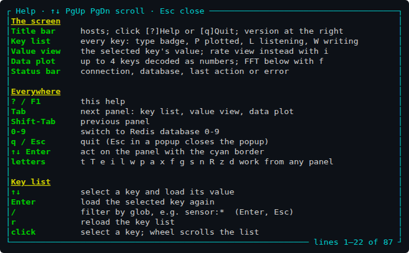
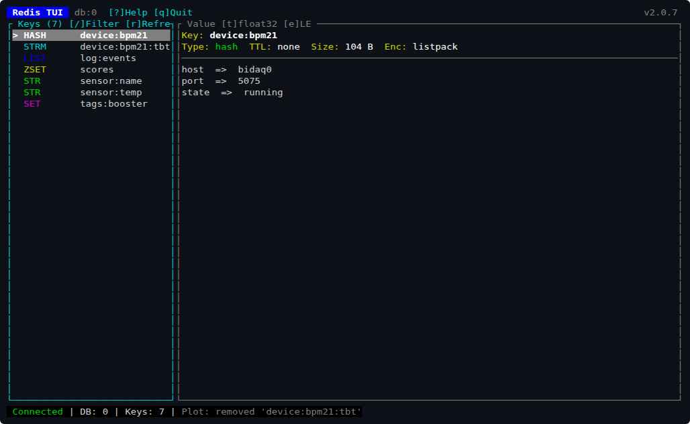
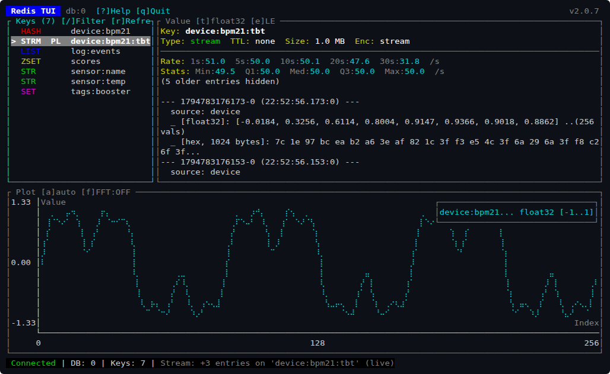
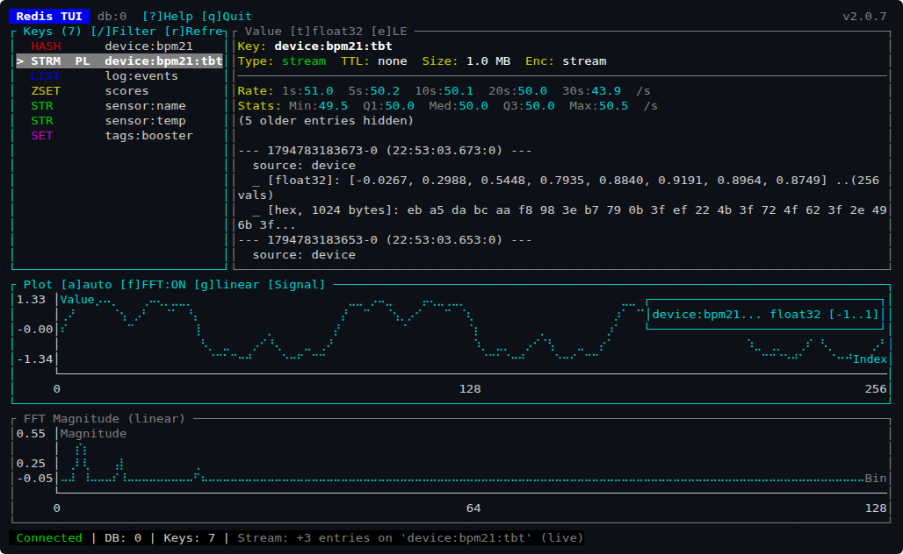
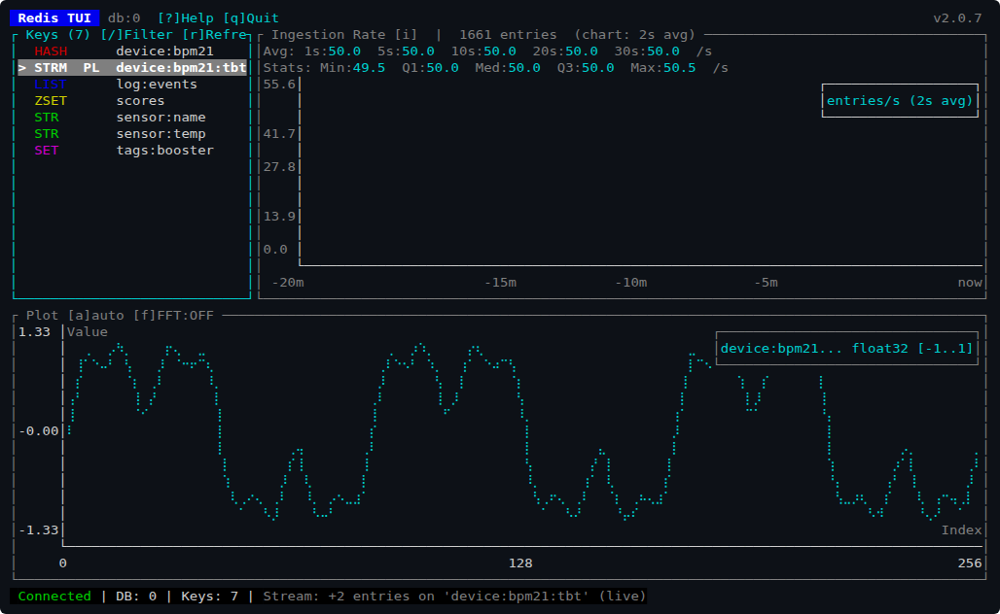
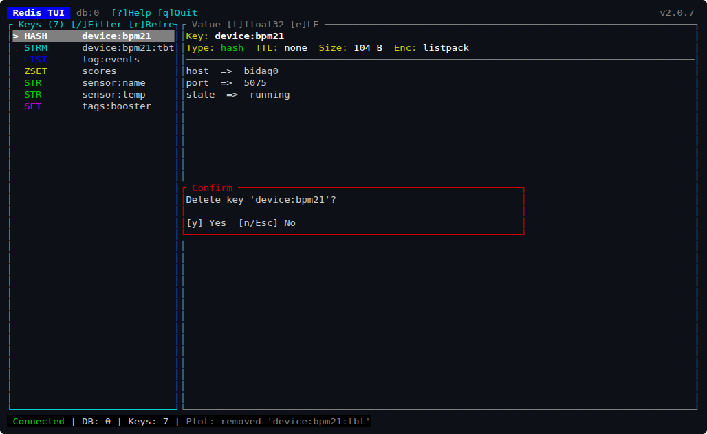

# Redis TUI Manual

This manual describes **redis-tui 2.0.8**.

redis-tui is a terminal browser for Redis in the style of Redis Insight. It
lists the keys of one or more Redis servers, shows each value, decodes binary
waveforms in streams as numbers, plots up to four keys with an FFT, and
watches live streams with their ingestion rate.

## Starting it

- **clx29 shell:** `redis-tui --hosts host[:port] ...` (personal shell command
  in `~/.tuibashrc`; it runs the image below). It is not on W5.
- **Anywhere with podman or docker:**

  ```bash
  podman run --rm -it --network=host adregistry.fnal.gov/instrumentation/redis-tui:latest \
    redis-tui --hosts bidaqt:6379
  ```

  With no `--hosts` it connects to `127.0.0.1:6379`. `redis-tui --help` lists
  every option and its environment variable ([below](#command-line-options)).

redis-tui talks to Redis only, not EPICS.

## Help

Press `?` or `F1`, or click **[?]Help** in the title bar. The help lists every
panel, popup, key, click and colour, and which keys write to Redis. Scroll with
`↑` `↓`, `PgUp` `PgDn`, `Home` `End` or the wheel; close it with `Esc`, `?`,
`F1`, `q` or a click. It fits an 80×24 terminal.



## Table of Contents

1. [Command Line Options](#command-line-options)
2. [Connecting to Redis](#connecting-to-redis)
3. [Interface Layout](#interface-layout)
4. [Navigation](#navigation)
5. [Key Management](#key-management)
6. [Editing Values](#editing-values)
7. [Data Plotting](#data-plotting)
8. [FFT Analysis](#fft-analysis)
9. [Stream Monitoring](#stream-monitoring)
10. [Ingestion Rate Monitoring](#ingestion-rate-monitoring)
11. [Signal Generator](#signal-generator)
12. [Mouse Controls](#mouse-controls)
13. [Multi-Host Mode](#multi-host-mode)
14. [Controls at a Glance](#controls-at-a-glance)
15. [Colours](#colours)
16. [What Writes to Redis](#what-writes-to-redis)
17. [Troubleshooting](#troubleshooting)

---

## Command Line Options

```
redis-tui [OPTIONS]
```

| Flag | Environment | Description | Default |
|------|-------------|-------------|---------|
| `--hosts <HOSTS>...` | `REDIS_TUI_HOSTS` | Hosts: `host`, `host:port`, or a full `redis://` URL. Repeatable. Accepts `--host` as a deprecated alias. | `127.0.0.1:6379` |
| `--username <USERNAME>` | `REDIS_TUI_USERNAME` | Username for hosts without their own | None |
| `--password <PASSWORD>` | `REDIS_TUI_PASSWORD` | Password for hosts without their own | None |
| `-d, --db <DB>` | `REDIS_TUI_DB` | Database for hosts without their own | `0` |
| `--max-value-items <N>` | `REDIS_TUI_MAX_VALUE_ITEMS` | Most list/set/zset/hash elements fetched per value load | `1000` |
| `--rate-history <MINUTES>` | `REDIS_TUI_RATE_HISTORY` | Rolling window for the rate chart | `20` |
| `--rate-avg-window <SECONDS>` | `REDIS_TUI_RATE_AVG_WINDOW` | Sliding average for the plotted rate line | `2` |
| `--connect-retries <N>` | `REDIS_TUI_CONNECT_RETRIES` | Retries for a host that is not up yet | `5` |
| `--connect-timeout <SECONDS>` | `REDIS_TUI_CONNECT_TIMEOUT` | Socket timeout per attempt | `3` |

A flag beats its environment variable, which beats the default. `--help` prints
each variable next to its flag.

### Examples

```bash
# Default localhost connection
redis-tui

# Remote host with custom port
redis-tui --hosts 10.0.0.5:6380

# Authenticated connection
redis-tui --hosts myredis --password secret

# Full URL with database selection
redis-tui --hosts redis://:password@host:6379/2

# Several hosts aggregated into one view
redis-tui --hosts db1 db2:6380 redis://svc:pw@db3/2

# The same, from the environment
REDIS_TUI_HOSTS="db1 db2:6380" redis-tui
```

### Migrating from 1.x

`--port`, `--url` and `--hosts-file` were removed in 2.0.0. One flag now names
where to connect.

`--host` survives as a deprecated alias for `--hosts`, so a 1.x command that
named a single host on the default port keeps working unchanged. Because
`--port` is gone, anything that set a port must move to the `host:port` form.
New commands should use `--hosts`; the alias is not shown in `--help`.

| 1.x | 2.0 |
|-----|-----|
| `--host db1` | works as-is; `--hosts db1` preferred |
| `--host db1 --port 6380` | `--hosts db1:6380` |
| `--url redis://:pw@db1/2` | `--hosts redis://:pw@db1/2` |
| `--hosts-file hosts.txt` | `--hosts $(grep -v '^#' hosts.txt \| tr '\n' ' ')` |

Entries mix freely, and `--username`/`--password`/`--db` apply to any entry that
does not carry its own:

    redis-tui --hosts db1 db2:6380 redis://svc:pw@db3/2 \
              --username admin --password s3cret --db 1

---

## Connecting to Redis

### Host Entries

`--hosts` takes one or more entries. It is repeatable, and several entries may
follow it at once. Each entry is one of three forms:

| Form | Example | Port | Credentials and database |
|------|---------|------|--------------------------|
| Bare host | `db1` | `6379` | From `--username`/`--password`/`--db` |
| `host:port` | `db1:6380` | As given | From `--username`/`--password`/`--db` |
| Full URL | `redis://svc:pw@db1:6380/2` | As given | Self-contained; the flags are ignored |

A URL entry carries everything it needs, so hosts with different credentials can
sit side by side in one list.

Connection details are built programmatically rather than by formatting a URL
string, so a password containing `/`, `#`, `?` or `@` connects verbatim instead
of being mangled.

Every entry is validated before any connection is attempted. If any entry is
unparseable the run stops and lists all of them at once, so one run tells you
everything to fix:

```
Error: 2 invalid host entries:
  localhost:70000
    invalid port '70000'
  !!!
    '!!!' is not a valid host
```

**TLS is not supported.** This build declares `redis = "1.0"` with no TLS
feature, so a `rediss://` entry is rejected at parse time rather than failing
later at connect.

A host that parses but is not up yet is retried `--connect-retries` times, each
attempt bounded by `--connect-timeout`. Hosts that never come up are reported and
the session continues without them; if none come up at all, the run fails.

If a host stops answering mid-session, its scan failure is named on the status
line rather than printed, which would draw over the interface:

```
Loaded 42 keys (1 host unreachable: 127.0.0.1:6380)
```

Its keys are absent from the list while it is down, so the count alone would
otherwise read as "those keys were deleted".

In multi-host mode, keys from all hosts are aggregated into a single list. If the same key exists on multiple hosts, a collision warning is displayed when selecting it. The status bar shows which host each key belongs to.

### Large Collections

Lists, sets, sorted sets and hashes are read up to `--max-value-items` elements
(1000 by default) rather than whole. Arrow-key navigation loads the selected
key automatically, so without a cap, scrolling onto a large key pulls all of it
into memory on the main thread and the interface stops responding.

When a collection is larger than the cap the value pane says so:

```
Showing first 1000 of 5000000 — raise --max-value-items to see more
```

Sets and hashes are read with `SSCAN`/`HSCAN` and stopped at the cap, so the
server never assembles the whole reply either. Lists and sorted sets take their
first N in order, so the same elements appear on every load.

Strings are never truncated: a partial binary value is a corrupt one.

---

## Interface Layout

The interface consists of three panels:

```
+------------------+----------------------------------+
|                  |                                  |
|    Key List      |         Value View               |
|                  |                                  |
|                  |                                  |
+------------------+----------------------------------+
|                                                     |
|                    Data Plot                        |
|                                                     |
+-----------------------------------------------------+
```

- **Key List** (left): Shows all keys with type badges (`str`, `hash`, `list`, `set`, `zset`, `stream`). Status indicators appear next to keys: colored `P` for plotted keys, green `L` for active listeners, red `W` for running signal generators.
- **Value View** (right): Displays key metadata (type, TTL, encoding, size) and the formatted value.
- **Data Plot** (bottom): Visualizes data as waveforms. When FFT is enabled, the plot splits into a signal view (top) and frequency view (bottom).
- **Status Bar** (bottom line): Shows the current operation status, active database, and host info.
- **Title Bar** (top): Shows the app name, the hosts, the clickable **[?]Help** and **[q]Quit**, and the version.

The key list with a hash selected:



A live stream (`l`) decoded as float32 (`t`) and plotted (`p`):



The same with the FFT (`f`):



The ingestion rate view (`i`) of the stream being listened to:



---

## Navigation

| Key | Action |
|-----|--------|
| `Tab` | Cycle to next panel (Key List -> Value View -> Data Plot -> Key List) |
| `Shift+Tab` | Cycle to previous panel |
| `Up` / `Down` | Navigate keys (Key List panel) or scroll value (Value View panel) |
| `Enter` | Load the selected key's value |
| `0-9` | Switch to Redis database 0-9 |
| `?` / `F1` | Open the help (scroll with Up/Down, PgUp/PgDn, Home/End, wheel; close with Esc, ?, F1, q or a click) |
| `q` / `Esc` | Quit the application |

### Data Plot Navigation (when Data Plot panel is focused)

| Key | Action |
|-----|--------|
| `Up` | Select signal sub-plot (when FFT is active) |
| `Down` | Select FFT sub-plot (when FFT is active) |

---

## Key Management

### Filtering Keys

| Key | Action |
|-----|--------|
| `/` | Enter filter mode |

Type a glob pattern (e.g., `user:*`, `stream:*`) and press `Enter` to apply. Press `Esc` to cancel. The filter uses Redis SCAN MATCH syntax.

### Refreshing

| Key | Action |
|-----|--------|
| `r` | Refresh the key list from Redis |

### Creating Keys

| Key | Action |
|-----|--------|
| `n` | Open new key popup |

In the popup:
- Use `Left`/`Right` to select the key type: string, hash, list, set, zset, or stream
- `Tab`/`Shift+Tab` to navigate between fields
- `Enter` to create the key
- `Esc` to cancel

### Editing Values

| Key | Action |
|-----|--------|
| `s` | Edit the selected key's value |

Opens an edit popup with fields appropriate to the key type. For multi-entry types (lists, sets, sorted sets, streams, hashes), you can submit multiple entries — the popup stays open after each `Enter`. Press `Esc` to close.

### Renaming Keys

| Key | Action |
|-----|--------|
| `R` (Shift+R) | Rename the selected key |

### Deleting Keys

| Key | Action |
|-----|--------|
| `d` | Delete the selected key |

A confirmation prompt appears. Press `y` to confirm or `n`/`Esc` to cancel.

### Setting TTL

| Key | Action |
|-----|--------|
| `z` | Set TTL on the selected key |

Enter the TTL in seconds. Use `-1` to remove the TTL (persist the key).

---

## Editing Values

### Binary Encoding Mode

When editing values, you can encode numeric input as binary data:

| Key | Action |
|-----|--------|
| `Ctrl+B` | Toggle binary encoding mode on/off |
| `Ctrl+T` | Cycle binary data type (Int8 through Float64) |
| `Ctrl+E` | Toggle endianness (little/big) |

When binary mode is on, your numeric input is encoded into raw bytes using the selected data type and endianness before being stored in Redis.

### Edit Popup Controls

| Key | Action |
|-----|--------|
| `Tab` / `Shift+Tab` | Navigate between fields |
| `Enter` | Submit the edit |
| `Esc` | Cancel / close (for multi-entry types, closes after all entries are submitted) |
| `Backspace` | Delete character |

---

## Data Plotting

The data plot panel visualizes Redis values as waveforms. It supports all value types:

- **Strings**: Decoded as binary blobs using the selected data type
- **Streams**: Plots the binary data from the last entry's `_`-prefixed field
- **Lists**: Parses items as numbers, or decodes as binary blobs
- **Sorted Sets**: Plots the scores
- **Hashes**: Parses values as numbers, or decodes as binary blobs

### Plot Controls

| Key | Action |
|-----|--------|
| `p` | Toggle the selected key in/out of the plot (FIFO, max 4 keys) |
| `t` | Cycle data type forward (Int8, Int16, Int32, UInt8, UInt16, UInt32, Float32, Float64, String, Blob) |
| `T` (Shift+T) | Cycle data type backward |
| `e` | Toggle endianness (little/big) |
| `a` | Auto-fit all plot axis limits |
| `x` | Open plot settings popup |

### Multi-Key Plotting

Up to 4 keys can be plotted simultaneously. Each key gets a unique color:

| Slot | Color |
|------|-------|
| 1 | Cyan |
| 2 | Yellow |
| 3 | Green |
| 4 | Magenta |

When a 5th key is added, the oldest is evicted (FIFO). Colors are reassigned based on slot position. The legend in the top-right of the chart shows each key's name and current value range.

Per-key Y-axis scales are displayed on the left side of the chart, color-coded to match each trace.

### Plot Settings Popup (x)

| Key | Action |
|-----|--------|
| `Tab` / `Shift+Tab` | Navigate between fields |
| `Enter` | Apply settings |
| `Esc` | Cancel |

Fields: X Min, X Max (shared across all keys), plus per-key Y Min / Y Max when multiple keys are plotted. Leave blank or set both to 0 for auto-scaling.

### Plot Viewport

The plot shows the most recent 2,000 data points by default (auto-scrolling window). Use the plot settings popup or mouse controls to customize the viewport.

---

## FFT Analysis

| Key | Action |
|-----|--------|
| `f` | Toggle FFT frequency analysis on/off |
| `g` | Toggle FFT Y-axis scale between linear and log |

When FFT is enabled, the plot splits horizontally:
- **Top**: Signal waveform (time domain)
- **Bottom**: Frequency spectrum (FFT magnitude)

Use `Up`/`Down` arrows (with Data Plot panel focused) to select which sub-plot is active for axis controls.

FFT is computed in a background thread and updates automatically as new data arrives. The DC offset (mean) is removed before computation for cleaner visualization.

---

## Stream Monitoring

### Live Listening

| Key | Action |
|-----|--------|
| `l` | Toggle live stream listener for the selected key |

When a listener is active:
- New entries are received via background XREAD polling (1-second timeout)
- The plot updates in real-time with incoming data
- The status bar shows the entry count per update
- A green `L` indicator appears next to the key in the list
- Up to 4 listeners can run simultaneously (FIFO eviction if exceeded)
- Stream entries in memory are capped at 10 per key (`MAX_STREAM_ENTRIES`), newest kept - the last 5 are displayed and the newest is plotted. Rate statistics come from a separate 60-second ring of entry timestamps, so they survive the entries being discarded

Press `l` again on the same key to stop its listener.

---

## Ingestion Rate Monitoring

While a stream listener is active, redis-tui tracks how many entries arrive per second and displays this in two places.

### Rate and Stats Lines (Value View)

When listening to a stream key, two lines are injected at the top of the value view:

```
Rate:  1s:X  5s:X  10s:X  20s:X  30s:X  /s   [⚠ lagging Ns]  [⚠ N gaps]
Stats: Min:X  Q1:X  Med:X  Q3:X  Max:X  /s
```

- **Rate line**: rolling averages over 1, 5, 10, 20, and 30 second windows. A gap warning (`⚠ N gaps`) appears if timestamp jumps suggest entries were written and trimmed before XREAD could read them.
- **Stats line**: five-number summary (min, Q1, median, Q3, max) of the rate history. During the initial warmup period a countdown is shown instead: `warming up — Xs until data available`.

### Rate View

| Key | Action |
|-----|--------|
| `i` | Toggle ingestion rate view (stream key + active listener required) |

Press `i` to replace the right panel with a full rate chart:

```
┌─ Ingestion Rate [i]  |  N entries  [| lagging Ns]  (chart: 2s avg) ──┐
│ Avg: 1s:X  5s:X  10s:X  20s:X  30s:X  /s            │
│ Stats: Min:X  Q1:X  Med:X  Q3:X  Max:X  /s           │
│ [chart — rolling rate over --rate-history window]     │
└───────────────────────────────────────────────────────┘
```

- The chart plots entries/sec as a rolling line using the `--rate-avg-window` sliding average.
- Red markers on the chart indicate detected gaps where the arrival interval jumped by more than 1.85× the expected rate, suggesting entries were trimmed before being read.
- The chart window is controlled by `--rate-history` (default 20 minutes).

Press `i` again to return to the normal value view.

### CLI Flags

| Flag | Description | Default |
|------|-------------|---------|
| `--rate-history <MINUTES>` | How far back the rate chart shows (rolling window) | `20` |
| `--rate-avg-window <SECONDS>` | Sliding window used to compute the plotted rate line | `2` |

---

## Signal Generator

The signal generator writes synthetic waveform data to Redis streams, useful for testing and demonstration.

| Key | Action |
|-----|--------|
| `w` | Open signal generator popup (if on a stream key) / stop if already running |

### Signal Generator Popup

| Field | Description | Default |
|-------|-------------|---------|
| Wave Type | sine, square, sawtooth, triangle (use Left/Right to select) | sine |
| Data Type | Numeric encoding type (use Left/Right to select) | Float32 |
| Cycles/Entry | Number of wave cycles per stream entry | 1.0 |
| Amplitude | Wave amplitude | 1.0 |
| Noise | Random noise amplitude (0 = none) | 0.0 |
| Samples/Entry | Number of samples per stream entry | 100 |
| Entries/Sec | Rate of stream entry generation | 10.0 |

Navigation:
- `Tab`/`Shift+Tab` to move between fields
- `Left`/`Right` to change Wave Type and Data Type selections
- Type numeric values into text fields
- `Enter` to start the generator
- `Esc` to cancel

When running:
- A red `W` indicator appears next to the key in the list
- The stream is trimmed to the last 100 entries to prevent unbounded growth
- Up to 4 generators can run simultaneously (FIFO eviction if exceeded)
- Press `w` on the same key to stop its generator

### Typical Workflow

1. Create or select a stream key
2. Press `w` to open the signal generator popup
3. Configure the wave parameters and press `Enter`
4. Press `l` to start listening to the same key
5. Press `p` to add the key to the plot
6. Press `f` to enable FFT and see the frequency spectrum

---

## Mouse Controls

| Action | Effect |
|--------|--------|
| Click a key | Select it and load its value |
| Click **[?]Help** / **[q]Quit** | Open the help / quit |
| Wheel over the key list | Scroll the list (the selection stays) |
| Wheel over the value view | Scroll the value |
| Hold Shift | Mouse goes to the terminal: select and copy text |
| Click + drag | Pan the plot viewport |
| Scroll up | Zoom in (centered on cursor position) |
| Scroll down | Zoom out (centered on cursor position) |
| Hover | Shows crosshair with data coordinates |

When FFT is active, mouse actions apply to whichever sub-plot (signal or FFT) the cursor is hovering over.

Press `a` to reset to auto-fit limits after manual panning/zooming.

---

## Multi-Host Mode

When `--hosts` names more than one host, redis-tui connects to all of them and
aggregates their keys into a single view.

### Key Collision Handling

If the same key name exists on multiple hosts:
- A warning is shown in the status bar when selecting the key
- The host label is displayed in the value view header

### Host Labels

Host labels are derived from the entry (the `host:port` portion, with auth stripped). These appear in the status bar and collision warnings to identify which host a key belongs to.

---

## Controls at a Glance

The same rows as the in-app help.

| Key / click | Action |
|---|---|
| `?` / `F1` / click **[?]Help** | Help |
| `Tab` / `Shift-Tab` | Next / previous panel: key list, value view, data plot |
| `0`-`9` | Switch to Redis database 0-9 |
| `q` / `Esc` / click **[q]Quit** | Quit (`Esc` in a popup closes the popup) |
| `↑` `↓`, `Enter` | Act on the panel with the cyan border |
| `↑` `↓` (key list) | Select a key and load its value |
| `Enter` (key list) | Load the selected key again |
| `/` | Filter by glob, e.g. `sensor:*` (`Enter`, `Esc`) |
| `r` | Reload the key list |
| `↑` `↓` (value view) | Scroll |
| `t` / `T` | Data type forward / back (Int8 ... Float64) |
| `e` | Endianness little / big |
| `i` | Ingestion rate view (a stream you listen to) |
| `l` | Listen live on the stream (up to 4); `l` again stops |
| `w` | Signal generator on the stream; `w` again stops |
| `p` | Plot the selected key on / off (up to 4) |
| `↑` `↓` (data plot) | Signal / FFT plot (with FFT on) |
| `a` | Autoscale |
| `x` | Type the limits (X and each key's Y) |
| `f` | FFT on / off |
| `g` | FFT scale linear / log |
| wheel / drag (plot) | Zoom at the pointer / pan |
| hover (plot) | Read the value under the pointer |
| `Tab` / `Shift-Tab` (popup) | Next / previous field |
| `←` `→` (popup) | New key: its type; signal generator: wave, data type |
| `Enter` (popup) | Apply (list, set, stream entries stay open) |
| `Esc` (popup) | Cancel |
| `Ctrl-B` (edit) | Binary encoding on / off |
| `Ctrl-T` `Ctrl-E` (edit, binary) | Data type / endianness |
| `y` / `n` | Confirm / cancel a delete |
| `s` `n` `R` `z` `d` | Edit, new key, rename, TTL, delete (see below) |

The letter keys work from any panel.

---

## Colours

| Colour | Meaning |
|---|---|
| green `STR` | string |
| blue `LIST` | list |
| magenta `SET` | set |
| yellow `ZSET` | sorted set |
| red `HASH` | hash |
| cyan `STRM` | stream |
| green `L` / red `W` | Listening / signal generator writing |
| coloured `P` | Plotted, in its trace colour |
| yellow `!` | The same key name on two hosts |
| red `⚠` | Stream gaps, or a rate that lags |
| status bar green / red | Connected / not connected |
| cyan border | The panel that has the keys |
| grey | Hints; no data |

There is one fixed palette (no theme switch). Plots are drawn in braille
characters, so they work in any terminal; there is no pixel mode.

---

## What Writes to Redis

| Key | Write |
|---|---|
| `s` | Edit the selected key's value |
| `n` | New key |
| `R` | Rename the selected key |
| `z` | Set the TTL (`-1` keeps it for ever) |
| `d` | Delete the selected key |
| `w` | Signal generator: `XADD` + `XTRIM` until stopped |

`s`, `n`, `R` and `z` open a popup: nothing is written until `Enter`. `d` asks
`y` / `n` first:



`w` writes for as long as it runs; `w` again stops it, and quitting stops every
generator. Everything else only reads.

---

## Troubleshooting

- **"Connecting…" then an error.** The host is not reachable from where the
  container runs: check the host name and port, and that the container has
  `--network=host`. `--connect-retries` and `--connect-timeout` wait longer for
  a host that is still booting.
- **No keys.** Check the database (`0`-`9`, or `--db`) and the filter (`/`,
  then `Enter` with an empty pattern).
- **A collection shows only part of its elements.** Values are capped at
  `--max-value-items` (default 1000); the value view says how many are hidden.
- **Numbers look wrong.** Pick the data type with `t` / `T` and the byte order
  with `e`.
- **Terminal too small.** Panels shrink; the help scrolls. 80×24 works.
- **Mouse does nothing, or text cannot be selected.** The terminal must pass
  mouse events (xterm, Ghostty do; over ssh use `ssh -t`). Hold Shift to select
  text with the terminal instead.
